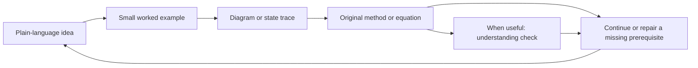

# Paper Visual Coach

A paper-reading skill for beginners who learn through diagrams, small examples,
and plain-language explanations.

It combines adaptive reading companionship with source-grounded visual teaching.
The instructions are written in English. Lessons default to Simplified Chinese,
with other languages available on request.

## See it through examples

[Read the illustrated examples](docs/visual-examples.md) or download the
[offline interactive demo](docs/reading-demo.html) and open it in a browser.
GitHub renders the guide and diagram; the HTML file runs locally after download.

| Example | Core idea | Try it |
|---|---|---|
| ADaPT | Execute first, decompose on failure | Step through success, recursion, or a depth-limit failure |
| Flow | Finishing a running batch can unlock another task | Watch parent counts and task readiness change |
| Graph metrics | A visible graph makes an equation concrete | Add one edge and calculate the standard deviation |
| Experimental evidence | A mean requirement score differs from full task success | Toggle three requirements and inspect both outcomes |

These are teaching illustrations, not reproduced experiments or measured learning
gains. Each example identifies its source and simplifying assumptions.

## The learning loop

One concept at a time is the default. A reader can ask for a complete explanation,
a faster pace, a derivation, or uninterrupted teaching at any point.

## What it does

- Starts with the paper's problem and a lightweight reading map.
- Shows covered, current, and pending reading units at major transitions.
- Explains unfamiliar background only when it is needed.
- Uses flowcharts, search trees, state tables, and numerical examples.
- Maps teaching examples back to the actual paper and states their limits.
- Checks a reader's counterexample against explicit assumptions and the source.
- Explains what an equation computes before walking through its symbols.
- Uses occasional predictions or restatements to identify misunderstanding.
- Can create an offline-readable HTML visual notebook when useful.
- Keeps compact reading checkpoints when the reader requests saving progress.

## Use the skill

Install this repository as a skill with your agent's supported skill installer,
or copy its contents into a skill folder named `paper-visual-coach` in the location
your agent supports. Keep `SKILL.md`, `references/`, and `agents/` together.

Provide a paper PDF, an accessible paper URL, or a specific passage. Ask:

> Use paper-visual-coach to guide me through this paper in Simplified Chinese.
> My background is limited. Start with a small example and a diagram, introduce
> prerequisites when needed, then explain the original method and equations.
> Ask a short understanding question at useful boundaries and adapt to my answer.

For an English lesson:

> Use paper-visual-coach in English. Explain this algorithm with a tiny example
> and a step-by-step state diagram before connecting it to the pseudocode.

For a visual notebook:

> Turn the part we have covered into one self-contained HTML reading notebook.
> Include the running example, diagrams, necessary equations, and source locations.
> Mark anything we have not covered yet as pending.

## Files

| File | Purpose |
|---|---|
| `SKILL.md` | Routing and core coaching instructions |
| `references/visual-guide.md` | Diagram selection, interaction, and HTML checks |
| `references/learning-notes.md` | Compact reading checkpoints and resuming |
| `agents/openai.yaml` | Optional agent UI metadata |
| `docs/visual-examples.md` | Four worked examples and English prompts |
| `docs/reading-demo.html` | Self-contained offline interactive companion |
| `assets/visual-overview.svg` | Reading approach at a glance |

This is an instruction-based skill, not a PDF parser or a standalone application.
It uses the host agent's source-reading, diagramming, and preview capabilities.
Neither inspiration skill nor a dedicated rendering package is required.

## Evidence and limitations

Paper-specific claims must be grounded in the original source. Teaching examples,
redrawn data, original figures, background knowledge, and inference remain distinct.
Incomplete source access is disclosed. Understanding is checked through the
reader's responses rather than inferred from a friendly acknowledgement.

Validation so far covers skill metadata, local references, and packaging. No
independent learner study or end-to-end paper-coaching evaluation has been run.
The overview diagram was visually checked and the example controls were tested
with a DOM implementation. The demo's browser layout and native input behavior
remain unchecked because local browser preview was unavailable. Visual output
still requires preview and interaction checks when it is created.

## Acknowledgements

This independently written skill draws on complementary ideas from:

- [Paper Reading Coach](https://github.com/ITerminaTor996/paper-reading-coach-skill):
  question-led reading, understanding checks, and adaptive reading state.
- [Paper Reading Skill](https://github.com/xiaofengShi/paper-reading-skill):
  visual explanations of mechanisms, equations, and experiments with source evidence.

The skill was originally authored as a `teach` variant in a local skills-management
workflow. This repository contains only the standalone publication bundle.
