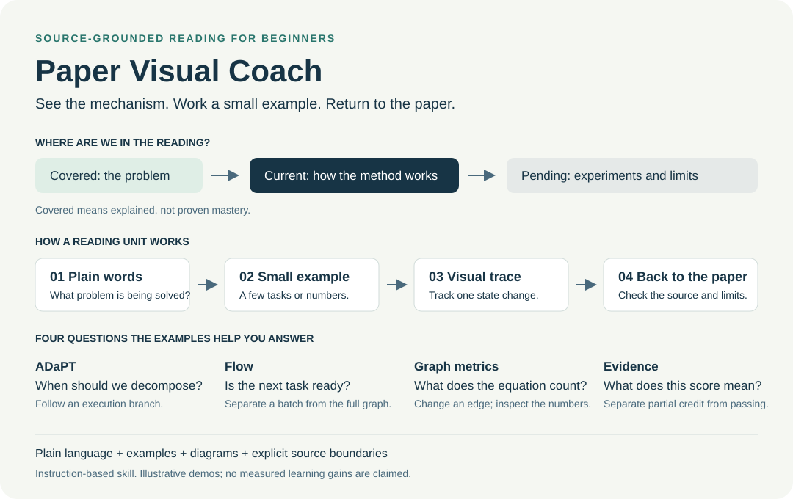
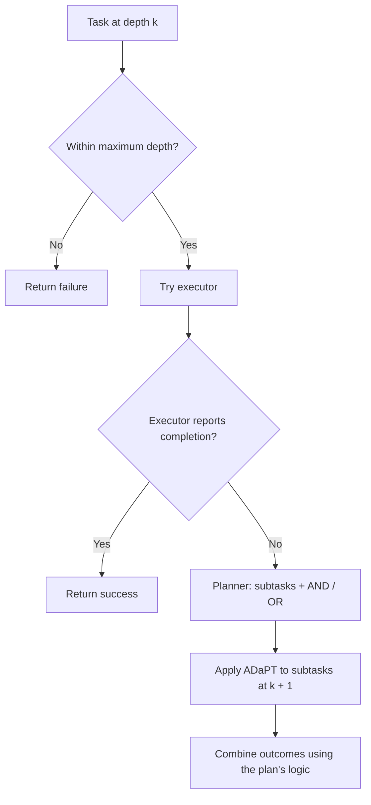
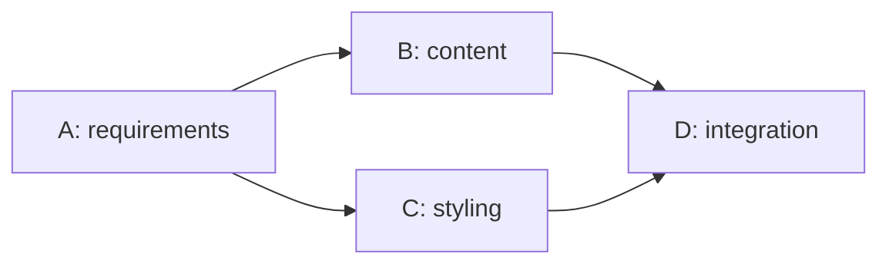
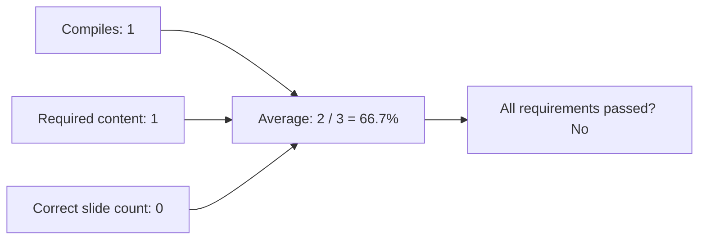

# Four examples of visual paper coaching

The skill is designed to make a paper's mechanism, quantities, and evidence easier
to follow. These examples show the teaching approach; they do not establish
measured learning gains or reproduce either paper's experiments.

Try the [interactive companion](reading-demo.html): download it and open it in a
browser. It is one self-contained file, works offline, and does not run an agent.
GitHub displays its source; the repository does not currently host a live demo.

Validation: the overview was rendered and visually inspected. The companion's
script was executed with a DOM implementation to check success, recursion,
depth-limit failure, resets, final states, both graph variants, and all eight
requirement combinations. Browser preview was unavailable in the authoring
environment; HTML layout and native keyboard/input behavior remain unchecked.

## 1. Understand a control flow: ADaPT

**Reading question:** When is planning needed?

**Plain-language idea:** ADaPT tries execution first. A failed attempt triggers
decomposition, and the same rule is applied to each subtask. Recursive calls have
a maximum-depth guard.

**Small teaching example:** Put a clean mug on a desk.

1. The first attempt fails to find a mug.
2. Decompose into find, clean, and place, connected by AND.
3. If finding still fails, decompose that subtask into search alternatives.
4. Search the countertop OR the cabinet. Finding the mug on the countertop makes
   the cabinet search unnecessary.
5. Continue with cleaning and placing.

**What the visual helps with:** The reader sees which failure causes which new
plan, rather than treating recursion as an unexplained word. In the companion,
change the outcome to see direct success or a depth-limit failure.

**Return to the paper:** [ADaPT, Section 3 and Algorithm 1](https://aclanthology.org/2024.findings-naacl.264.pdf).
The sequence above fixes outcomes for teaching. Original completion is an
LLM-generated heuristic; the demo does not establish objective task success.

## 2. Understand runtime state: Flow

**Reading question:** Does finishing the running batch finish the whole workflow?

Consider this teaching workflow:

| Observation | B | C | D | What happens next? |
|---|---|---|---|---|
| Both parents running | In progress | In progress | Blocked | Wait |
| One parent completed | Completed | In progress | Blocked | Wait for C |
| Current batch completed | Completed | Completed | Ready | Execute D |
| Final task completed | Completed | Completed | Completed | All nodes completed |

The graph can stay unchanged while D becomes ready. The optional graph-update
branch and the completion condition answer different questions.

**What the visual helps with:** Explicit states reveal the scope of "finished."
A reader's objection can then be checked against a particular graph and condition.

**Return to the paper:** [Flow v2, Algorithm 2 and Appendix D.4](https://arxiv.org/html/2501.07834v2).
Algorithm 2 loops while a node remains incomplete. The experiment's update strategy
waits for running tasks before scheduling further work. The table uses simplified
algorithm statuses and is not a claim about independent output validation.
Ready and blocked are teaching labels for not-started nodes with zero or nonzero
incomplete parents.

## 3. Understand an equation: change one edge

**Reading question:** What is a graph score actually measuring?

Use the same four-node diamond. Every node has two direct connections. Adding
the direct edge A to D changes the total connection counts to 3, 2, 2, 3.

| Quantity | Diamond | Diamond plus A to D |
|---|---:|---:|
| Tasks per layer | 1, 2, 1 | 1, 2, 1 |
| Average tasks per layer | 4 / 3 | 4 / 3 |
| Connection counts for A, B, C, D | 2, 2, 2, 2 | 3, 2, 2, 3 |
| Mean connection count | 2 | 2.5 |
| Population standard deviation | 0 | 0.5 |

For the added-edge graph, each count differs from 2.5 by 0.5. Squaring, averaging,
and taking the square root gives 0.5.

**What the visual helps with:** The equation becomes a calculation on visible
objects. Toggle the extra edge in the companion and compare both quantities.

**Return to the paper:** [Flow v2, Section 3](https://arxiv.org/html/2501.07834v2#S3).
Its dependency score is the standard deviation of node connection counts; it is
not a direct edge-count metric. Its selection rule favors higher parallelism,
then lower dependency complexity when parallelism ties. These teaching graphs
do not prove speedup or optimality. Averaging task counts uses the size of each
layer's task set, written as |S_t| here to make the count explicit.

## 4. Understand evidence: partial credit versus complete success

**Reading question:** What does a reported percentage mean?

Use a hypothetical slide deck with three binary requirements:

| Computation | This illustrative deck |
|---|---|
| Mean requirement score | 66.7% |
| Passes every requirement | No |

**What the visual helps with:** The reader can explain the denominator and the
aggregation before interpreting a result. In the companion, switch requirements
on or off and watch both outcomes change.

**Return to the paper:** [Flow v2, Appendix B.1](https://arxiv.org/html/2501.07834v2).
That evaluation averages three binary requirement scores. Our deck and its 66.7%
are illustrative, not an additional experimental result or a success probability.

## What makes this coaching approach useful?

| Skill behavior | What the reader can see or do |
|---|---|
| A visible reading route | Locate covered, current, and pending material |
| Plain words before notation | Connect a new term to a familiar action |
| Small examples and state traces | Follow one change without juggling an entire system |
| Explicit source boundaries | Tell an author claim from a teaching assumption or proposed extension |
| Checks only when useful | Continue reading without a quiz after every explanation |
| Counterexamples checked against the source | Discuss a valid objection without an unstated answer key |
| Metric definitions and evidence limits | Explain what a result supports and what remains untested |

These are intended teaching benefits, not claims from a controlled learner study.
An explanation counts as covered; understanding is recorded separately from an
actual restatement or application.

## Example prompts

> Use paper-visual-coach in English. I have not read this paper. Show the reading
> route, explain the authors' method through a small example, and return to the
> original algorithm. Continue without asking a question after every turn.

> Explain this equation using a graph with four nodes. Show what changes when
> one edge is added, label all assumptions, and distinguish the teaching example
> from experimental data.

> I think this method is worse than ADaPT. Check my reasoning against both
> papers and separate my design preference from a directly measured comparison.
